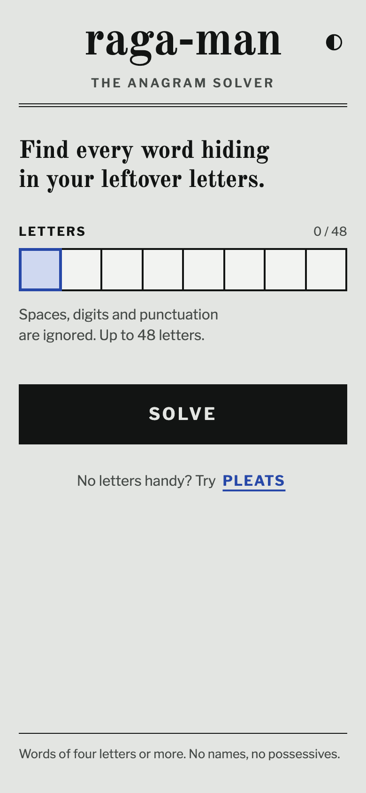
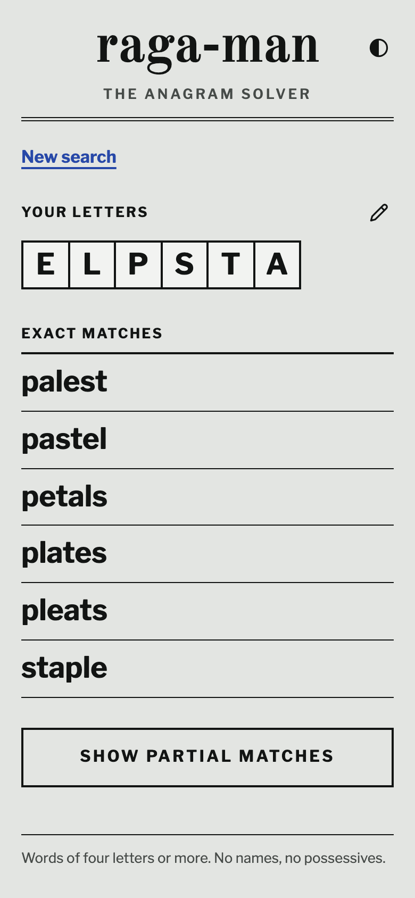

# raga-man

**Live:** https://raga-man.narcisolobo.workers.dev/

A fast, mobile-friendly anagram solver built for the end of a NYT Strands puzzle. Type the letters you have left and see every word that uses all of them.

<p>
  
  
</p>

## What it does

- Exact matches first: every word that uses all of your letters.
- Partial matches on demand: words built from a subset of the letters, grouped by length (longest first), alphabetical within a group.
- A curated word list with no proper nouns, possessives or words under 4 letters, so results are usable without filtering by eye.
- Results work from the URL alone (`/results?letters=...`), so they can be refreshed and shared.
- Light and dark themes.

## How it works

A static [Astro](https://astro.build) and TypeScript site with no backend and no accounts. The home page downloads no word data. The word trie is fetched only when partial matches are requested. It deploys to Cloudflare Workers static assets.

## Development

Requires Node 26 or newer and [pnpm](https://pnpm.io).

```sh
pnpm install
pnpm dev          # builds the word data, then starts the dev server
pnpm test         # unit tests (vitest)
pnpm test:e2e     # end-to-end tests (Playwright)
pnpm build        # builds data, type-checks, builds the site into dist/
pnpm deploy:cf    # build, then wrangler deploy
```

`pnpm build:data` regenerates the word data in `public/data/` from [data/wamerican.txt](data/wamerican.txt) using [scripts/build-data.ts](scripts/build-data.ts). It runs automatically as part of `dev` and `build`.

## Docs

- [PRODUCT.md](PRODUCT.md): users, purpose and scope
- [DESIGN.md](DESIGN.md): the visual system
- [SPEC.md](SPEC.md): behavior spec
- [data/README.md](data/README.md): where the word list comes from

## Credits

- Word list: Debian's `wamerican` package, built from [SCOWL](http://wordlist.sourceforge.net/) by Kevin Atkinson. It keeps its own permissive licence; see [data/COPYRIGHT-wamerican](data/COPYRIGHT-wamerican).
- Fonts: [Old Standard TT](https://fontsource.org/fonts/old-standard-tt) and [Libre Franklin](https://fontsource.org/fonts/libre-franklin), both open source and served through Fontsource.

## License

The code in this repository is released under the [MIT License](LICENSE). The word list and fonts are covered by their own licences, noted above.
