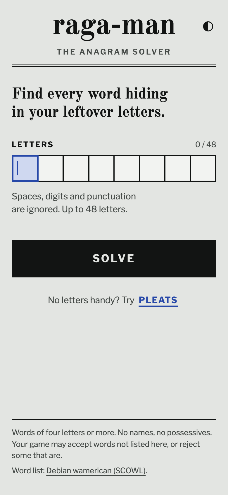
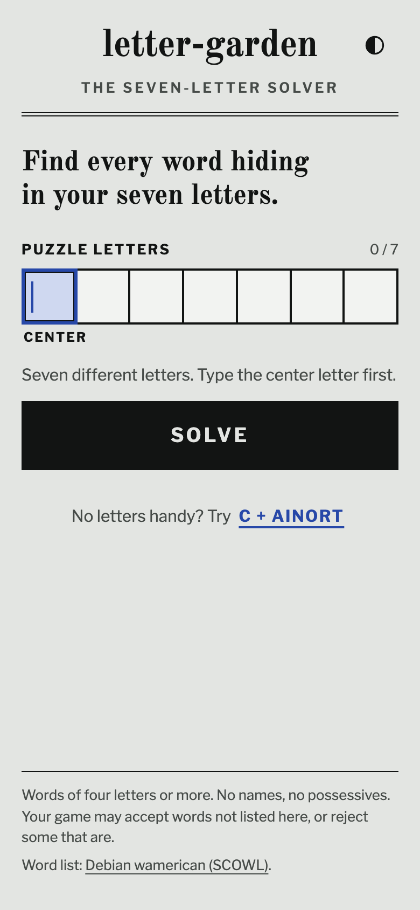

# Solver suite

Small, static word-puzzle tools built with Astro and TypeScript, listed at [solversuite.app](https://solversuite.app/). Each solver has its own input, search rules, word-data build, tests, and Cloudflare Worker deployment on its own subdomain.

<table>
  <tr>
    <td align="center" valign="top" width="50%">
      <a href="apps/raga-man/README.md"></a>
      <p><strong><a href="apps/raga-man/README.md">raga-man</a></strong><br>The anagram solver<br><a href="https://raga-man.solversuite.app/">Live site</a></p>
      
    </td>
    <td align="center" valign="top" width="50%">
      <a href="apps/letter-garden/README.md"></a>
      <p><strong><a href="apps/letter-garden/README.md">letter-garden</a></strong><br>The seven-letter solver<br><a href="https://letter-garden.solversuite.app/">Live site</a></p>
      
    </td>
  </tr>
</table>

## Development

Requires Node 26 or newer and pnpm. Run from the repository root:

```sh
pnpm install
pnpm build               # build every app
pnpm test                # unit tests across the workspace
pnpm test:e2e            # browser tests across the workspace; build first
```

Each app has the same set of commands, named after it:

```sh
pnpm dev:raga-man        # development server on port 4321
pnpm build:raga-man
pnpm preview:raga-man    # serve the production build
pnpm deploy:raga-man     # build and deploy only this app

pnpm dev:letter-garden   # development server on port 4322
pnpm build:letter-garden
pnpm preview:letter-garden
pnpm deploy:letter-garden

pnpm dev:home            # the suite index, on port 4320
pnpm build:home
pnpm preview:home
pnpm deploy:home
```

`pnpm dev` and `pnpm preview` are shorthand for raga-man. Use `pnpm --filter <app> <command>` for any other app command. There is no suite-wide deployment; each app owns its Wrangler configuration and output directory.

Two commands regenerate checked-in assets for every app:

```sh
pnpm icons               # favicons and touch icons, from packages/icons
pnpm screenshots         # README screenshots, from each app's production build; build first
```

## Repository layout

- `apps/raga-man/`, `apps/letter-garden/`: one directory per solver, each with its own search rules, dictionary policy, views, tests, and product records (`PRODUCT.md`, `SPEC.md`).
- `apps/home/`: the suite index at the bare domain. A new solver goes in its `src/solvers.ts`; `pnpm icons` supplies its icon.
- `packages/ui/`: the shared Astro shell, design tokens, fonts, letter squares, and theme toggle.
- `packages/word-data/`: the shared trie codec and dictionary preparation.
- `packages/icons/`: the app icon generator.
- `packages/screenshots/`: the README screenshot script.
- `data/`: source dictionaries with provenance and license notices. Generated assets belong in each app's `public/data/` and are ignored by Git.
- `docs/design-system.md`: the shared visual system and app-specific components.
- `docs/solver-suite-plan.md`: product direction and planned solvers.

Names may be playful but should suggest the tool's job. Never use a game's own name for a tool. Use American English in documentation and interface copy.

## License

The code in this repository is released under the [MIT License](LICENSE). The word list and fonts are covered by their own licenses; see [data/wamerican/COPYRIGHT](data/wamerican/COPYRIGHT) and the credits in each app's README.
