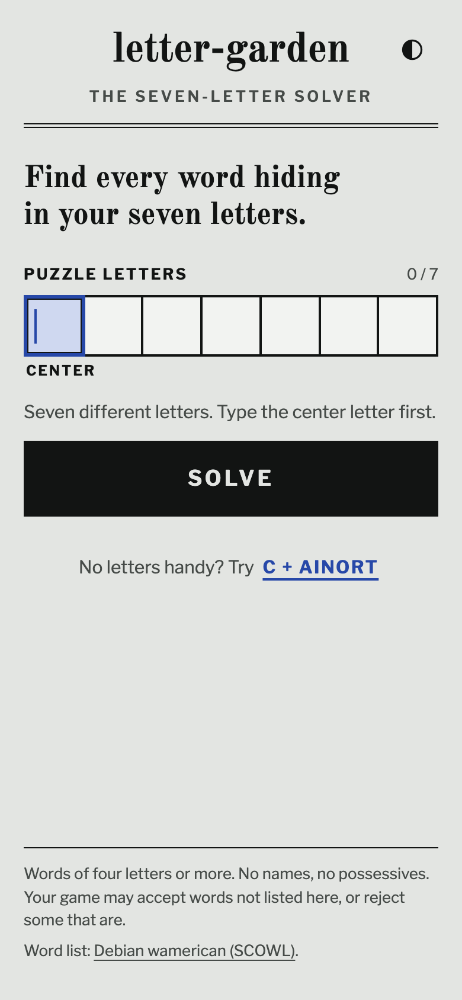
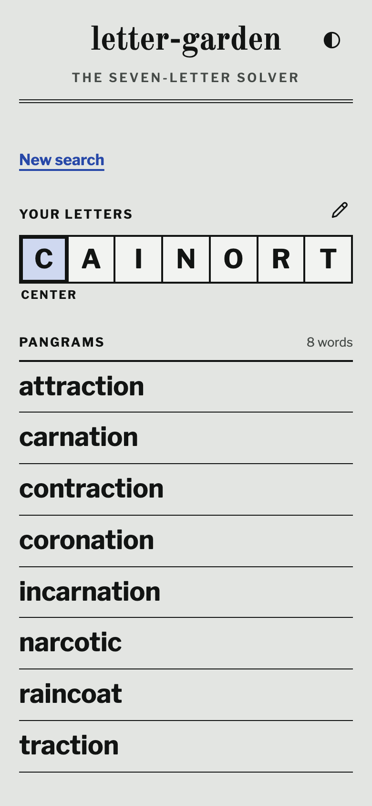

# letter-garden

<p>
  
  
</p>

A mobile-friendly solver for seven-letter puzzles. Enter seven different letters, center letter first, and find every word of four or more letters that uses the center letter and only those seven, repeats allowed. Pangrams, the words that use all seven, come first; the rest follow, grouped by length. Results can be shared through `/results?letters=...&required=...`.

The app is static and runs entirely in the browser. The home page downloads no word data; the results page fetches the trie once.

## Development

From the repository root, use `pnpm dev:letter-garden` and the other commands in the [root README](../../README.md#development). From this directory:

```sh
pnpm dev                  # development server on port 4322
pnpm test
pnpm build
pnpm test:e2e             # requires a production build
pnpm preview              # port 4322
pnpm deploy:cf
```

Playwright starts its own preview on port 4422. `dev` and `build` generate `public/data/trie.txt` from [the source dictionary](../../data/wamerican/README.md). To check the Worker bundle locally after building, run `pnpm exec wrangler deploy --dry-run`.

The screenshots above come from `pnpm screenshots` at the repository root.

## Documentation

- [Product brief](PRODUCT.md)
- [Behavior spec](SPEC.md)
- [Shared design system](../../docs/design-system.md)
- [Suite plan](../../docs/solver-suite-plan.md)

## Credits

The Debian wamerican dictionary is derived from SCOWL; see its [license notice](../../data/wamerican/COPYRIGHT). Fonts are Old Standard TT and Libre Franklin, served locally through Fontsource.
