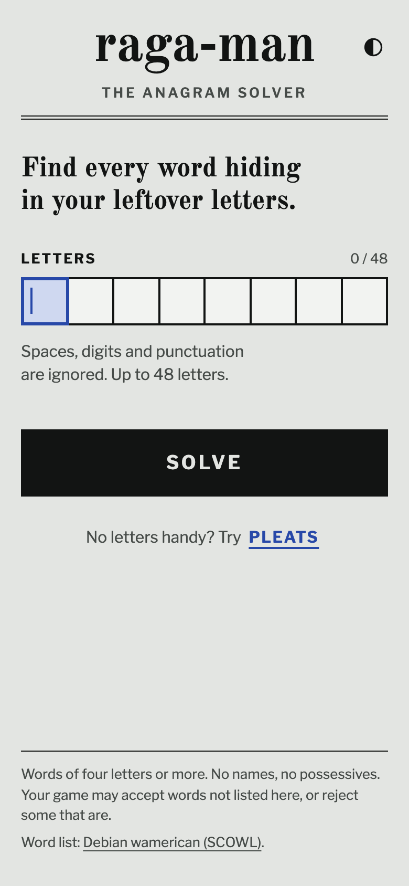
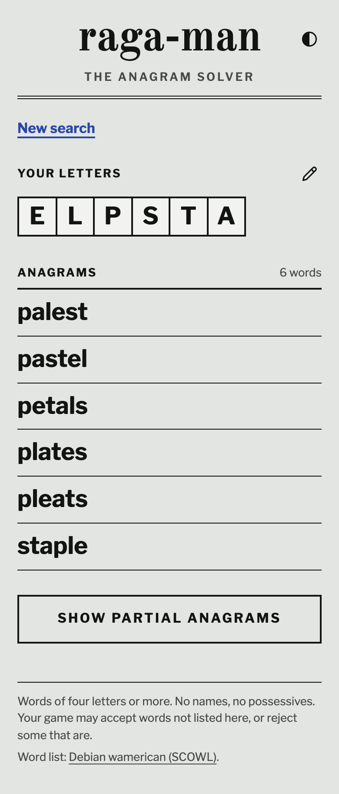

# raga-man

[Live site](https://raga-man.narcisolobo.workers.dev/)

<p>
  
  
</p>

A mobile-friendly anagram solver for leftover puzzle letters. Anagrams appear first; partial anagrams are available on demand, grouped by length. Results can be shared through `/results?letters=...`.

The app is static and runs entirely in the browser. The home page downloads no word data, and the trie is fetched only when partial anagrams are requested.

## Development

From the repository root, use `pnpm dev:raga-man` and the other commands in the [root README](../../README.md#development). From this directory:

```sh
pnpm dev                  # development server on port 4321
pnpm test
pnpm build
pnpm test:e2e             # requires a production build
pnpm preview
pnpm deploy:cf
```

Playwright starts its own preview on port 4421. `dev` and `build` generate `public/data/exact.json` and `public/data/trie.txt` from [the source dictionary](../../data/wamerican/README.md). Deployment uses this directory's `wrangler.jsonc`, preserving the `raga-man` Worker name and existing routes.

The screenshots above come from `pnpm screenshots` at the repository root.

## Documentation

- [Product brief](PRODUCT.md)
- [Behavior spec](SPEC.md)
- [Shared design system](../../docs/design-system.md), whose source paths are relative to this app
- [Suite plan](../../docs/solver-suite-plan.md)

## Credits

The Debian wamerican dictionary is derived from SCOWL; see its [license notice](../../data/wamerican/COPYRIGHT). Fonts are Old Standard TT and Libre Franklin, served locally through Fontsource.
